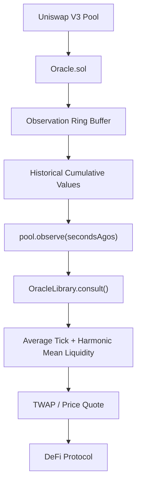

# Uniswap V3 Price Oracle — Audit Notes


### ⭐️ Part 1 — Oracle Fundamentals and Mathematics 
1. Oracle Fundamentals
2. Spot Price vs TWAP
3. Tick and Price Relationship
4. TWAP Calculation
5. Geometric Mean vs Arithmetic Mean

### ⭐️ Part 2 — Oracle Architecture and Data Structure
6. Oracle Architecture
7. Observation Structure
8. Cumulative Tick
9. Seconds Per Liquidity

### ⭐️ Part 3 — Observation Recording and Storage
10. Observation Ring Buffer
11. `initialize()`
12. `transform()`
13. `write()`
14. `grow()` and Observation Cardinality

### ⭐️ Part 4 — Historical Data and TWAP Calculation
15. `observe()` and `observeSingle()`
16. Historical Observation Lookup
17. Interpolation
18. Binary Search
19. `OracleLibrary.consult()`
20. `getQuoteAtTick()`

### ⭐️ Part 5 — Edge Cases and Technical Details
21. Timestamp and Integer Overflow
22. Negative Tick Rounding
23. Insufficient Observation History
24. Zero Liquidity
25. Observation Cardinality and Same-Block Updates
26. `snapshotCumulativesInside()`

### ⭐️ Part 6 — Oracle Security and Auditing
27. Spot Price Manipulation
28. TWAP Manipulation
29. Liquidity and TWAP Window
30. Common Oracle Integration Mistakes
31. Auditor's Checklist
32. Source Code Reading Order

---

# Part 1 — Oracle Fundamentals and Mathematics ⭐️

## 1. Oracle Fundamentals

An oracle provides price information that smart contracts can use.

**Why do we need an oracle?**

- Spot price represents the current pool price.
- Spot price can be temporarily manipulated through swaps.
- Historical prices reduce the influence of short-term price spikes.
- Lending, derivatives, and other DeFi protocols can use historical price information.

**Main idea:** Uniswap V3 records cumulative information over time so that a caller can calculate a Time-Weighted Average Price (TWAP).

> TWAP reduces short-term manipulation risk. It does not eliminate manipulation.

## 2. Spot Price vs TWAP

| Spot Price | TWAP |
|---|---|
| Current pool price | Average price over a time window |
| Can change immediately | Uses historical information |
| More sensitive to short-term manipulation | Reduces the influence of short-term spikes |
| Read from current pool state | Calculated using cumulative observations |

**Important:** `slot0.sqrtPriceX96` represents the current pool price, not a historical TWAP.

## 3. Tick and Price Relationship

Uniswap V3 represents price using ticks.

\[
\boxed{P(i)=1.0001^i}
\]

- `i` = tick.
- Each tick represents a price ratio change by a factor of 1.0001.
- Tick is a logarithmic representation of price.
- Raw price is token1/token0.

Token decimals must be considered when converting raw price into a human-readable price.

## 4. TWAP Calculation

Normal time-weighted average price:

### Normal TWAP

$$
TWAP =
\frac{\int_{t_0}^{t_1} P(t)\,dt}{t_1 - t_0}
$$

### Uniswap V3 TWAP

Uniswap V3 calculates an average tick using cumulative ticks:

$$
AverageTick =
\frac{C_{now} - C_{past}}{\Delta t}
$$

Then, it converts the average tick into a price:

$$
P_{TWAP} = 1.0001^{AverageTick}
$$

**Important:** This produces a time-weighted geometric mean price, not an arithmetic average of prices.

### Example

| Period | Tick | Duration |
|---|---:|---:|
| First hour | 100 | 3,600 sec |
| Second hour | 200 | 3,600 sec |

Calculate the average tick:

$$
AverageTick =
\frac{100(3600) + 200(3600)}{7200}
$$

$$
AverageTick = 150
$$

Convert the average tick into the TWAP price:

$$
P_{TWAP} = 1.0001^{150}
$$

## 5. Geometric Mean vs Arithmetic Mean

- Arithmetic mean: averages the actual prices.
- Geometric mean: averages logarithmic price changes.

Uniswap V3 averages ticks and converts the result back into a price.

Therefore:

The time-weighted geometric mean price is:

$$
P_{TWAP} =
\left(
\prod_k P_k^{\Delta t_k}
\right)^{1/T}
$$

Where:

- `P_k` = price during interval `k`
- `Δt_k` = duration of interval `k`
- `T` = total elapsed time

Where `T` is the total time period.

---

# Part 2 — Oracle Architecture and Data Structure ⭐️

## 6. Oracle Architecture



**Responsibilities:**

| Component | Responsibility |
|---|---|
| Uniswap V3 Pool | Maintains current price, tick, and observation state |
| `Oracle.sol` | Records and retrieves observations |
| Observation buffer | Stores cumulative data |
| `observe()` | Returns cumulative values for requested times |
| `OracleLibrary` | Calculates average tick and harmonic mean liquidity |
| Consumer protocol | Uses the resulting price or liquidity information |

## 7. Observation Structure

Production Uniswap V3 uses:

```solidity
struct Observation {
    uint32 blockTimestamp;
    int56 tickCumulative;
    uint160 secondsPerLiquidityCumulativeX128;
    bool initialized;
}
```

| Field | Purpose |
|---|---|
| `blockTimestamp` | Observation timestamp |
| `tickCumulative` | Accumulated tick × elapsed time |
| `secondsPerLiquidityCumulativeX128` | Accumulated seconds per active liquidity, scaled by 2^128 |
| `initialized` | Indicates whether the observation is valid |

**Note:** Simplified learning implementations may omit the liquidity accumulator. Production V3 includes it.

## 8. Cumulative Tick

Cumulative tick records the tick multiplied by elapsed time.

\[
\boxed{
C_{new}=C_{old}+(tick\times\Delta t)
}
\]

Example:

| Tick | Duration | Increment |
|---:|---:|---:|
| 100 | 5 sec | 500 |
| 120 | 3 sec | 360 |
| 90 | 2 sec | 180 |
| **Total** | **10 sec** | **1,040** |

\[
AverageTick=\frac{1040}{10}
\]

\[
\boxed{AverageTick=104}
\]

### Why cumulative tick?

Instead of storing the price every second, Uniswap accumulates tick over time. Two historical cumulative values are enough to calculate an average tick over an interval.

## 9. Seconds Per Liquidity

The production oracle also records how much time passes relative to active in-range liquidity.

The seconds-per-liquidity accumulator increases approximately by:

$$
\Delta SPL =
\frac{\Delta t \times 2^{128}}{\max(1, L)}
$$

Where:

- `Δt` = elapsed seconds.
- `L` = active in-range liquidity.
- `2^128` = fixed-point scaling factor.

Harmonic mean liquidity:

\[
\boxed{
L_{harmonic}=
\frac{\Delta t\times2^{128}}{\Delta SPLC}
}
\]

**Remember:**

- `tickCumulative` → average tick / geometric mean price.
- `secondsPerLiquidityCumulativeX128` → harmonic mean active liquidity.
- Active liquidity is not TVL or total token reserves.

---

# Part 3 — Observation Recording and Storage ⭐️

## 10. Observation Ring Buffer

Uniswap V3 stores observations in a circular buffer.

**Why?**

- Keeps storage bounded.
- Reuses old storage slots.
- Supports historical queries within available history.
- Does not need to store a new observation every second.

Maximum observation cardinality: `65,535`.

### Example

For a buffer of size 4:

```text
Index:  0   1   2   3

Next index = (3 + 1) % 4 = 0
```

The next write wraps around and can overwrite an older observation.

## 11. `initialize()`

Initializes the oracle's first observation.

- Sets the initial timestamp.
- Sets cumulative tick to zero.
- Marks the observation as initialized.
- Initializes observation cardinality and cardinalityNext.

Initially, the pool has one initialized observation.

## 12. `transform()`

Calculates cumulative values for a new timestamp.

```solidity
uint32 delta = timestamp - last.blockTimestamp;

int56 tickCumulative =
    last.tickCumulative + int56(tick) * int56(uint56(delta));
```

Main operation:

The cumulative tick is updated as:

$$
C_{new} =
C_{old} + tick \times \Delta t
$$

The previous tick represents the elapsed interval before a swap changes the tick.

## 13. `write()`

Writes a new observation.

Main responsibilities:

1. Read the latest observation.
2. Skip if the timestamp has not changed.
3. Expand active cardinality when appropriate.
4. Calculate the next buffer index.
5. Calculate new cumulative values.
6. Store the observation.

**Important:** Multiple swaps in the same block timestamp do not create multiple time-based observations.

## 14. `grow()` and Observation Cardinality

Three important fields:

| Field | Meaning |
|---|---|
| `observationIndex` | Index of latest observation |
| `observationCardinality` | Current active capacity |
| `observationCardinalityNext` | Requested future capacity |

`grow()` prepares additional observation storage.

`increaseObservationCardinalityNext()` requests a larger capacity.

**Important distinctions:**

- Increasing capacity does not create historical observations.
- Actual cardinality expands as future observations are written.
- More capacity does not mean more historical data is already available.

---

# Part 4 — Historical Data and TWAP Calculation ⭐️

## 15. `observe()` and `observeSingle()`

The pool exposes:

```solidity
function observe(uint32[] calldata secondsAgos)
    external
    view
    returns (
        int56[] memory tickCumulatives,
        uint160[] memory secondsPerLiquidityCumulativeX128s
    );
```

Example:

```solidity
uint32[] memory secondsAgos = new uint32[](2);

secondsAgos[0] = 300;
secondsAgos[1] = 0;

(int56[] memory tickCumulatives, ) =
    pool.observe(secondsAgos);
```

Meaning:

- `300` → cumulative value from 300 seconds ago.
- `0` → cumulative value at the current time.

**Remember:** `observe()` returns cumulative data, not a ready-made TWAP.

`observeSingle()` calculates the cumulative values for one requested historical point.

## 16. Historical Observation Lookup

For a requested timestamp, the oracle:

1. Checks whether the timestamp matches an existing observation.
2. Interpolates if the timestamp falls between observations.
3. Transforms forward if the requested time is newer than the latest stored observation.
4. Reverts if the requested time is older than available history.

## 17. Interpolation

A requested timestamp can fall between two observations.

Example:

| Timestamp | Cumulative tick |
|---:|---:|
| 110 | 2,000 |
| 120 | 3,200 |

Calculate the value at timestamp 115:

Calculate the interpolated cumulative tick:

$$
C_{target} =
C_{before} +
\frac{C_{after} - C_{before}}{t_{after} - t_{before}}
(t_{target} - t_{before})
$$

Substitute the values:

$$
C_{target} =
2000 +
\frac{3200 - 2000}{120 - 110} \times 5
$$

$$
C_{target} = 2600
$$
## 18. Binary Search

Uniswap V3 uses binary search to find observations surrounding a requested timestamp.

Why?

- Efficient historical lookup.
- Avoids scanning every observation.
- Works with circular buffer storage.
- Handles timestamp ordering and wraparound logic.

**Audit focus:** Initialized slots, circular index ordering, and timestamp wraparound.

## 19. `OracleLibrary.consult()`

This is the main periphery helper for calculating average tick and harmonic mean liquidity.

Conceptually:

1. Calls `pool.observe([secondsAgo, 0])`.
2. Reads past and current cumulative values.
3. Calculates the cumulative differences.
4. Divides by elapsed time to obtain average tick.
5. Calculates harmonic mean liquidity.

### Average tick

Calculate the average tick:

$$
AverageTick =
\frac{C_{now} - C_{past}}{Time}
$$

### Price conversion

Convert the average tick into a price:

$$
Price = 1.0001^{AverageTick}
$$

### Negative tick rounding

Solidity signed integer division truncates toward zero.

```text
-101 / 10 = -10
```

Mathematical floor is `-11`.

`OracleLibrary.consult()` corrects negative non-divisible tick deltas so the average tick is rounded down.

**Audit point:** Verify negative tick rounding rather than assuming ordinary Solidity division gives mathematical floor.

## 20. `getQuoteAtTick()`

Converts a tick into a token quote.

Important considerations:

- Token0 and token1 order.
- Price direction.
- Token decimals.
- Integer precision and rounding.
- Large-value arithmetic.

Do not assume the returned raw quote is automatically a human-readable USD price.

---

# Part 5 — Edge Cases and Technical Details ⭐️ 

## 21. Timestamp and Integer Overflow

Production oracle uses bounded integer types:

| Variable | Type |
|---|---|
| Timestamp | `uint32` |
| Tick cumulative | `int56` |
| Seconds per liquidity cumulative | `uint160` |

Cumulative values can intentionally wrap within their integer widths.

**Audit point:** Understand the modular arithmetic and timestamp assumptions. Do not automatically classify every overflow as a vulnerability.

## 22. Negative Tick Rounding

Signed integer division truncates toward zero.

For negative values, this can differ from mathematical floor.

Example:

```text
-101 / 10 = -10  // Solidity truncation
-101 / 10 = -11  // Mathematical floor
```

`OracleLibrary.consult()` handles this distinction.

## 23. Insufficient Observation History

A protocol may request a TWAP period that the pool cannot provide.

Example:

- Protocol requests 30 minutes of history.
- Pool has only 10 minutes of usable history.
- Historical query reverts.

**Audit point:** Check whether the consuming protocol handles this failure safely.

## 24. Zero Liquidity

The seconds-per-liquidity calculation protects against division by zero using:

```solidity
Math.max(1, liquidity)
```

Check how the protocol interprets liquidity values and whether it assumes that a valid TWAP always means sufficient market depth.

## 25. Same-Block Updates and Cardinality

- Same timestamp → no new observation.
- Multiple swaps in the same block → no separate time intervals.
- `observationCardinalityNext` → requested capacity.
- `observationCardinality` → current active capacity.
- Capacity does not prove that the requested historical period exists.

## 26. `snapshotCumulativesInside()`

Returns cumulative data for a specific tick range:

- `tickCumulativeInside`
- `secondsPerLiquidityInsideX128`
- `secondsInside`

**Important:** This is range-specific position data, not the normal pool-wide TWAP query.

---

# Part 6 — Oracle Security and Auditing

## 27. Spot Price Manipulation

```text
Normal pool price
       |
       v
Attacker makes a large swap
       |
       v
Spot price moves temporarily
       |
       v
Protocol reads manipulated price
       |
       v
Attacker borrows more than intended
```

This is dangerous when a protocol trusts the current spot price for collateral valuation or borrowing limits.

## 28. TWAP Manipulation

TWAP reduces the influence of short-lived price changes because it considers a historical time window.

However, it is not manipulation-proof.

Manipulation resistance depends on:

- TWAP window length.
- Pool liquidity and depth.
- Cost of moving the price.
- How long the manipulated price is maintained.
- Number of blocks over which manipulation occurs.
- Other price validation checks.

## 29. Liquidity and TWAP Window

When auditing an oracle integration, investigate:

- Is the TWAP period long enough for the protocol's risk?
- Does the source pool have sufficient active liquidity?
- Can a large swap move the pool price significantly?
- Can an attacker sustain the manipulated price?
- Does the protocol validate unusual price movements?

A longer TWAP window can increase manipulation cost, but it may also make the price slower to react to genuine market changes.

## 30. Common Oracle Integration Mistakes

- Using `slot0.sqrtPriceX96` as if it were a TWAP.
- Choosing an extremely short TWAP period.
- Confusing average tick with arithmetic average price.
- Reversing token0/token1 orientation.
- Ignoring token decimals.
- Assuming `observationCardinalityNext` means historical data is available.
- Assuming TWAP cannot be manipulated.
- Ignoring insufficient observation history.
- Incorrect negative tick rounding.
- Not handling oracle query reverts.

## 31. Auditor's Checklist

### A. Price Calculation

- [ ] Is the protocol using TWAP instead of an unsafe spot price?
- [ ] Is the TWAP window suitable for the protocol's risk?
- [ ] Is cumulative tick subtraction correct?
- [ ] Is elapsed time correct?
- [ ] Is negative tick rounding handled?
- [ ] Is token0/token1 orientation correct?
- [ ] Are token decimals handled correctly?

### B. Observation History

- [ ] Does the requested historical period exist?
- [ ] Can the query revert due to insufficient history?
- [ ] Is cardinality distinguished from cardinalityNext?
- [ ] Is ring-buffer lookup correct?
- [ ] Are uninitialized observations handled?
- [ ] Is timestamp wraparound handled?

### C. Manipulation Resistance

- [ ] Can an attacker manipulate the source pool?
- [ ] Is pool liquidity sufficient?
- [ ] Can manipulation be sustained across blocks?
- [ ] Is the TWAP window too short?
- [ ] Are extreme prices validated?
- [ ] Is a secondary price source or deviation check needed?

### D. Liquidity Accumulator

- [ ] Is harmonic mean liquidity interpreted correctly?
- [ ] Is zero liquidity handled?
- [ ] Is active liquidity confused with TVL?
- [ ] Are accumulator scaling and calculations correct?

### E. Protocol Integration

- [ ] Does the consuming protocol handle oracle reverts?
- [ ] Does it reject stale or invalid prices?
- [ ] Can an unexpected price cause excessive borrowing or withdrawals?
- [ ] Are price bounds and decimal conversions correct?

## 32. Source Code Reading Order

Suggested order for auditing:

| Order | File | What to study |
|---|---|---|
| 1 | `contracts/libraries/Oracle.sol` | Observation, transform, write, grow, historical lookup |
| 2 | `contracts/UniswapV3Pool.sol` | Initialization, swaps, observation updates, observe |
| 3 | `contracts/interfaces/pool/IUniswapV3PoolState.sol` | `slot0`, observation state, public interface |
| 4 | `contracts/libraries/TickMath.sol` | Tick and price conversions |
| 5 | `contracts/libraries/OracleLibrary.sol` (v3-periphery) | Consult, average tick, liquidity, quote conversion |

---

# Final Revision — Complete Oracle Flow

```text
          UNISWAP V3 POOL
                 |
                 v
          CURRENT TICK
                 |
                 v
       TICK × ELAPSED TIME
                 |
                 v
          CUMULATIVE TICK
                 |
                 v
       OBSERVATION RING BUFFER
                 |
                 v
       observe(secondsAgos)
                 |
                 v
     HISTORICAL CUMULATIVE VALUES
                 |
                 v
       SUBTRACT + DIVIDE BY TIME
                 |
                 v
            AVERAGE TICK
                 |
                 v
        CONVERT TICK TO PRICE
                 |
                 v
              TWAP
                 |
                 v
          DEFI PROTOCOL
```

## Five Things to Remember During an Audit

1. `slot0` gives current pool state; it is not itself a TWAP.
2. `observe()` returns cumulative values, not a ready-made price.
3. Average tick converted to price gives a geometric mean.
4. Observation capacity does not guarantee historical data availability.
5. TWAP reduces manipulation risk but does not eliminate it.

**Core audit question:**

Can an attacker make the consuming protocol accept an economically incorrect price, even though Uniswap V3's oracle calculations are working as designed?


