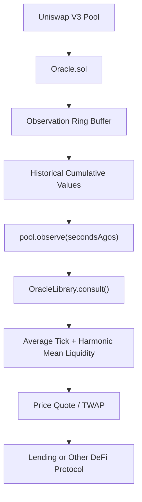

# Uniswap V3 Price Oracle 

## Index

1. [Oracle Fundamentals](#1-oracle-fundamentals)
2. [TWAP and Tick Mathematics](#2-twap-and-tick-mathematics)
3. [Oracle Architecture](#3-oracle-architecture)
4. [Observation Structure](#4-observation-structure)
5. [Cumulative Tick](#5-cumulative-tick)
6. [Observation Storage: `write()` and `grow()`](#6-observation-storage)
7. [Reading Historical Data: `observe()`](#7-reading-historical-data)
8. [Interpolation and Binary Search](#8-interpolation-and-binary-search)
9. [Calculating TWAP](#9-calculating-twap)
10. [Seconds Per Liquidity](#10-seconds-per-liquidity)
11. [Important Functions](#11-important-functions)
12. [Edge Cases and Technical Details](#12-edge-cases-and-technical-details)
13. [Oracle Security and Manipulation](#13-oracle-security-and-manipulation)
14. [Auditor's Checklist](#14-auditors-checklist)
15. [Important Source Files](#15-important-source-files)

---

## 1. Oracle Fundamentals

An oracle provides price information that smart contracts can use.

**Why does Uniswap V3 need an oracle?**

- Spot price represents the current pool price.
- Spot price can be manipulated temporarily through swaps.
- Historical prices help reduce the influence of short-term price manipulation.
- Lending, derivatives, and other DeFi protocols can use historical price information.

**Main idea:** Uniswap V3 records cumulative information over time so that a caller can calculate a Time-Weighted Average Price (TWAP).

> TWAP reduces short-term manipulation risk. It does not make manipulation impossible.

## 2. TWAP and Tick Mathematics

### Tick and price relationship

Uniswap V3 represents price using ticks.

\[
\boxed{P(i)=1.0001^i}
\]

- `i` = tick.
- Each tick represents a price ratio change by a factor of 1.0001.
- Tick is a logarithmic representation of price.

The raw price is token1/token0. Token decimals must be considered when converting it into a human-readable price.

### TWAP

## TWAP and Tick Mathematics

### Normal TWAP

A normal time-weighted average price is:

$$
TWAP = \frac{\int_{t_0}^{t_1} P(t)\,dt}{t_1 - t_0}
$$

### Uniswap V3 TWAP

Uniswap V3 stores cumulative ticks and uses them to calculate an average tick:

$$
AverageTick = \frac{C_1 - C_0}{t_1 - t_0}
$$

Then, it converts the average tick into a price:

$$
P_{TWAP} = 1.0001^{AverageTick}
$$

> **Important:** Averaging ticks and then converting the result into a price produces a time-weighted **geometric mean price**, not an arithmetic average of prices.

**Important:** Averaging ticks and converting the result into a price produces a time-weighted geometric mean price, not an arithmetic average of prices.

### Example

| Period | Tick | Duration |
|---|---:|---:|
| First hour | 100 | 3,600 sec |
| Second hour | 200 | 3,600 sec |

### Example

| Period | Tick | Duration |
|---|---:|---:|
| First hour | 100 | 3,600 seconds |
| Second hour | 200 | 3,600 seconds |

Calculate the average tick:

$$
AverageTick =
\frac{(100 \times 3600) + (200 \times 3600)}{7200}
$$

$$
AverageTick = 150
$$

Convert the average tick into the raw geometric mean price:

$$
P = 1.0001^{150}
$$
## 3. Oracle Architecture

### Complete data flow



**Responsibilities:**

- **Pool:** Maintains current price, tick, and observation state.
- **Oracle.sol:** Handles observation creation, storage, and historical lookup.
- **Observation buffer:** Stores cumulative data.
- **`observe()`:** Returns cumulative values for requested times.
- **OracleLibrary:** Calculates average tick and harmonic mean liquidity.
- **Consumer protocol:** Uses the resulting price or liquidity information.

## 4. Observation Structure

Production Uniswap V3 uses:

```solidity
struct Observation {
    uint32 blockTimestamp;
    int56 tickCumulative;
    uint160 secondsPerLiquidityCumulativeX128;
    bool initialized;
}
```

| Field | Purpose |
|---|---|
| `blockTimestamp` | Timestamp of the observation |
| `tickCumulative` | Accumulated tick × elapsed time |
| `secondsPerLiquidityCumulativeX128` | Accumulated seconds per active liquidity, scaled by 2^128 |
| `initialized` | Indicates whether the observation is valid |

**Remember:** Some learning materials use a simplified structure containing only timestamp, tick cumulative, and initialized. The production structure includes the liquidity accumulator too.

## 5. Cumulative Tick

Cumulative tick records how the tick changes over time.

\[
\boxed{
C_{new}=C_{old}+(tick\times\Delta t)
}
\]

Example:

| Tick | Duration | Cumulative increment |
|---:|---:|---:|
| 100 | 5 sec | 500 |
| 120 | 3 sec | 360 |
| 90 | 2 sec | 180 |
| **Total** | **10 sec** | **1,040** |

Calculate the average tick:

$$
AverageTick = \frac{1040}{10}
$$

$$
AverageTick = 104
$$

### Solidity concept: `transform()`

```solidity
uint32 delta = timestamp - last.blockTimestamp;

int56 tickCumulative =
    last.tickCumulative + int56(tick) * int56(uint56(delta));
```

The function calculates elapsed time and adds the current tick multiplied by that duration.

**Important:** The tick used represents the tick during the elapsed interval. When a swap changes the tick, the previous tick accounts for the time before the change.

## 6. Observation Storage

Uniswap V3 stores observations in a **circular buffer (ring buffer)**.

### Why a ring buffer?

- Keeps observation storage bounded.
- Reuses old storage slots.
- Allows historical queries within the available observation history.
- Avoids storing a new observation for every second.

### Observation index

`slot0` contains:

| Field | Meaning |
|---|---|
| `observationIndex` | Index of the latest observation |
| `observationCardinality` | Current observation buffer capacity |
| `observationCardinalityNext` | Requested future capacity |

Maximum cardinality: `65,535`.

### Ring buffer example

For a buffer of size 4:

```text
Index:  0   1   2   3
        ↑           ↑
      next       current

Next index = (3 + 1) % 4 = 0
```

The next write wraps around and can overwrite an older observation.

### `write()`

Main responsibilities:

1. Read the latest observation.
2. Skip writing if the timestamp has not changed.
3. Expand active cardinality when appropriate.
4. Calculate the next ring-buffer index.
5. Transform cumulative values.
6. Store the new observation.

**Important:** Normally, only one observation is written for a given block timestamp, even if multiple swaps occur in that block.

### `grow()` and `increaseObservationCardinalityNext()`

- `grow()` prepares additional observation storage.
- `increaseObservationCardinalityNext()` requests a larger observation capacity.
- Increasing the requested capacity does not create historical observations.
- The active cardinality grows as subsequent observations are written.

## 7. Reading Historical Data

### `observe()`

The pool exposes:

```solidity
function observe(uint32[] calldata secondsAgos)
    external
    view
    returns (
        int56[] memory tickCumulatives,
        uint160[] memory secondsPerLiquidityCumulativeX128s
    );
```

It returns cumulative values for requested points in time.

Example:

```solidity
uint32[] memory secondsAgos = new uint32[](2);

secondsAgos[0] = 300;
secondsAgos[1] = 0;

(int56[] memory tickCumulatives, ) =
    pool.observe(secondsAgos);
```

Meaning:

- `secondsAgos[0] = 300`: cumulative value from 300 seconds ago.
- `secondsAgos[1] = 0`: cumulative value at the current time.

Subtract the two cumulative values to calculate the average tick over the 300-second interval.

**Remember:** `observe()` returns cumulative data, not a ready-made TWAP price.

### Historical lookup

For a requested timestamp:

1. Check whether it matches an existing observation.
2. If it is between observations, interpolate.
3. If it is newer than the latest observation, transform forward using the current tick.
4. If it is older than available history, revert.

## 8. Interpolation and Binary Search

A requested timestamp may fall between two stored observations.

Example:

| Timestamp | Cumulative tick |
|---:|---:|
| 110 | 2,000 |
| 120 | 3,200 |

To estimate the cumulative value at timestamp 115:

Calculate the interpolated cumulative tick:

$$
C_{target} =
C_{before} +
\frac{C_{after} - C_{before}}{t_{after} - t_{before}}
(t_{target} - t_{before})
$$

Substitute the values:

$$
C_{target} =
2000 +
\frac{3200 - 2000}{120 - 110} \times 5
$$

$$
C_{target} = 2600
$$

### Binary search

Uniswap V3 uses binary search to find the observations surrounding a requested timestamp.

Why?

- Efficient historical lookup.
- Avoids scanning every observation.
- Works with the circular observation buffer.
- Handles timestamp ordering and wraparound logic.

**Audit point:** Check how the code distinguishes initialized observations from unused slots and handles timestamps around `uint32` overflow.

## 9. Calculating TWAP

The typical calculation uses two cumulative tick values.

```solidity
int56 tickDelta =
    tickCumulatives[1] - tickCumulatives[0];

int24 arithmeticMeanTick =
    int24(tickDelta / int56(uint56(secondsAgo)));
```

Conceptually:

Calculate the average tick:

$$
AverageTick = \frac{C_{now} - C_{past}}{Time}
$$

Then, convert the average tick into a price:

$$
Price = 1.0001^{AverageTick}
$$
### Negative tick rounding

Solidity signed integer division truncates toward zero.

For example:

```text
-101 / 10 = -10
```

Mathematical floor would be `-11`.

`OracleLibrary.consult()` corrects this behavior for negative non-divisible tick deltas so the average tick is rounded down.

**Audit point:** Do not assume ordinary signed division always gives the required mathematical floor.

## 10. Seconds Per Liquidity

Production observations also track active liquidity over time.

The accumulator increases approximately by:

### Seconds Per Liquidity

The seconds-per-liquidity accumulator increases approximately by:

$$
\Delta SPL =
\frac{\Delta t \times 2^{128}}{\max(1, L)}
$$

Where:

- `Δt` = elapsed seconds.
- `L` = active in-range liquidity.
- `2^128` = fixed-point scaling factor.

The `max(1, L)` prevents division by zero.

### Harmonic Mean Liquidity

The difference between two accumulator values is used to calculate harmonic mean liquidity:

$$
L_{harmonic} =
\frac{\Delta t \times 2^{128}}{\Delta SPLC}
$$

**Remember:**

- `tickCumulative` → average tick / geometric mean price.
- `secondsPerLiquidityCumulativeX128` → harmonic mean active liquidity.
- Active liquidity is not the same as TVL or total token reserves.

## 11. Important Functions

| Function | Purpose |
|---|---|
| `initialize()` | Initializes the first observation |
| `transform()` | Calculates cumulative values over elapsed time |
| `write()` | Writes a new observation |
| `grow()` | Prepares additional observation capacity |
| `observe()` | Reads historical cumulative values |
| `observeSingle()` | Reads or constructs one historical cumulative point |
| `binarySearch()` | Finds surrounding observations |
| `getSurroundingObservations()` | Finds observations around a target timestamp |
| `snapshotCumulativesInside()` | Reads cumulative data inside a tick range |
| `OracleLibrary.consult()` | Calculates average tick and harmonic mean liquidity |
| `OracleLibrary.getQuoteAtTick()` | Converts a tick into a token quote |

**Important distinction:** `snapshotCumulativesInside()` is for a specific tick range. It is not the normal pool-wide TWAP query.

## 12. Edge Cases and Technical Details

| Detail | What to remember |
|---|---|
| Same timestamp | No new observation is written |
| Multiple swaps in one block | They do not create multiple time intervals |
| Ring buffer | Older observations can be overwritten |
| Cardinality next | Requested capacity, not available history |
| Insufficient history | Historical query can revert |
| `uint32` timestamp | Timestamp arithmetic must handle wraparound |
| `int56` cumulative tick | Cumulative arithmetic uses bounded integer representation |
| `uint160` liquidity accumulator | Uses fixed-point and bounded integer arithmetic |
| Zero liquidity | Denominator is protected using `max(1, liquidity)` |
| Negative average tick | Requires correct floor rounding |
| Token decimals | Must be considered when interpreting quoted prices |

Cumulative values can intentionally wrap within their integer widths. Review the implementation's modular arithmetic and time assumptions rather than treating every overflow as automatically unsafe.

## 13. Oracle Security and Manipulation

### Spot price manipulation

```text
Normal pool price
      ↓
Attacker swaps a large amount
      ↓
Spot price moves temporarily
      ↓
Protocol reads manipulated spot price
      ↓
Attacker borrows more than intended
```

### Why TWAP helps

TWAP considers price history over a time window. A short-lived price spike has less influence over a longer averaging period.

However, TWAP is not manipulation-proof.

### What affects manipulation resistance?

- TWAP window length.
- Pool liquidity and depth.
- Cost of moving the price.
- How long the manipulated price is maintained.
- Number of blocks over which manipulation occurs.
- Whether the protocol uses other price validation checks.

### Common oracle mistakes

- Using `slot0.sqrtPriceX96` as if it were a historical TWAP.
- Using an extremely short TWAP window.
- Confusing average tick with average arithmetic price.
- Reversing token0/token1 price orientation.
- Ignoring token decimals.
- Assuming more observation capacity means more historical data.
- Assuming TWAP cannot be manipulated.
- Ignoring insufficient historical observations.
- Incorrectly handling negative tick rounding.

## 14. Auditor's Checklist

### A. Price calculation

- [ ] Is the protocol using TWAP instead of an unsafe spot price?
- [ ] Is the TWAP window sufficiently long for the protocol's risk?
- [ ] Is the cumulative tick subtraction correct?
- [ ] Is elapsed time calculated correctly?
- [ ] Is negative tick rounding handled correctly?
- [ ] Is token0/token1 orientation correct?
- [ ] Are token decimals handled correctly?

### B. Observation history

- [ ] Does the requested historical period actually exist?
- [ ] Can the query revert because history is insufficient?
- [ ] Is `observationCardinality` distinguished from `observationCardinalityNext`?
- [ ] Is the ring buffer lookup correct?
- [ ] Are uninitialized observations handled safely?
- [ ] Is timestamp wraparound handled correctly?

### C. Manipulation resistance

- [ ] Can an attacker manipulate the source pool?
- [ ] Is pool liquidity sufficient?
- [ ] Can the price be manipulated across multiple blocks?
- [ ] Is the TWAP window too short?
- [ ] Does the protocol validate extreme or unexpected prices?
- [ ] Is there a secondary price source or deviation check where needed?

### D. Liquidity accumulator

- [ ] Is harmonic mean liquidity interpreted correctly?
- [ ] Is zero liquidity handled?
- [ ] Is active in-range liquidity being confused with TVL?
- [ ] Are accumulator calculations and scaling correct?

### E. Integration

- [ ] Does the consuming protocol handle oracle reverts?
- [ ] Does it reject stale or invalid price data?
- [ ] Can an unexpected price cause excessive borrowing or withdrawals?
- [ ] Are price bounds and decimal conversions correct?

## 15. Important Source Files

Suggested reading order for an audit:

1. `contracts/libraries/Oracle.sol`
   - Observation structure, `transform()`, `write()`, `grow()`, historical lookup.

2. `contracts/UniswapV3Pool.sol`
   - Initialization, swap integration, observation updates, public `observe()`.

3. `contracts/interfaces/pool/IUniswapV3PoolState.sol`
   - `slot0`, observation state, public observation interface.

4. `contracts/libraries/TickMath.sol`
   - Tick-to-price and price-to-tick conversions.

5. `contracts/libraries/OracleLibrary.sol` (v3-periphery)
   - `consult()`, average tick, harmonic mean liquidity, quote conversion.

---

## Final Revision — Remember This Flow

```text
POOL PRICE / TICK
       |
       v
TICK × ELAPSED TIME
       |
       v
CUMULATIVE TICK
       |
       v
OBSERVATION RING BUFFER
       |
       v
observe(secondsAgos)
       |
       v
HISTORICAL CUMULATIVE VALUES
       |
       v
SUBTRACT + DIVIDE BY TIME
       |
       v
AVERAGE TICK
       |
       v
CONVERT TICK TO PRICE
       |
       v
TWAP PRICE
       |
       v
DEFI PROTOCOL
```

### Five things to remember during an audit

1. `slot0` gives current pool state; it is not itself a TWAP.
2. `observe()` returns cumulative values, not a ready-made price.
3. Average tick converted to price gives a geometric mean.
4. Observation capacity does not guarantee historical data availability.
5. TWAP reduces manipulation risk but does not eliminate it.

**Core audit question:** Can an attacker make the consuming protocol accept a price that is economically incorrect, even though the Uniswap V3 oracle calculations themselves are working as designed?


