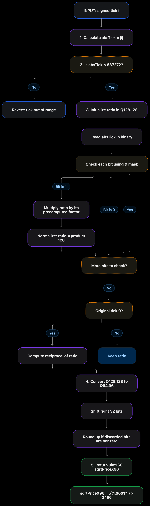

# Complete Module Flowchart — `getSqrtRatioAtTick()`

1. `absTick = |i|`
2. Require `absTick <= 887272`
3. Build `ratio = sqrt(1.0001^absTick)` in Q128.128
4. Convert `ratio` from Q128.128 to Q64.96
5. Return `uint160 sqrtPriceX96`

